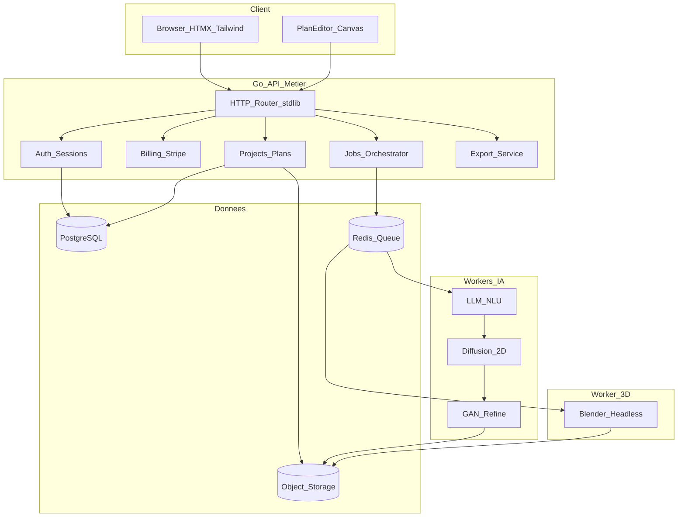
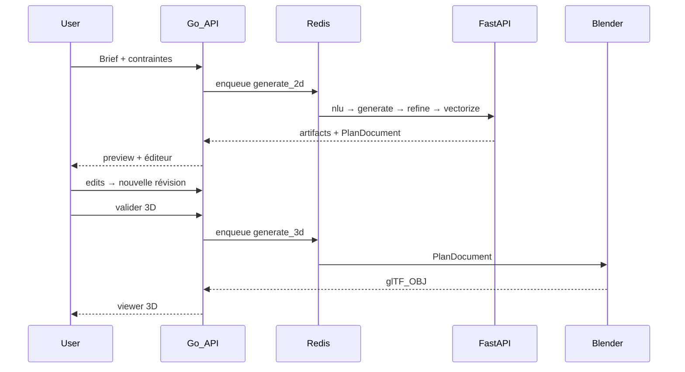

# Architecture système

## Vue d’ensemble

A-AI est un **monolithe modulaire Go** pour le métier (auth, projets, billing, orchestration), avec des **workers séparés** pour l’IA (FastAPI/GPU) et la 3D (Blender). Les fichiers longs transitent par Redis ; les artefacts sont stockés en S3-compatible.



## Décisions d’architecture

| Décision | Choix | Justification |
|----------|--------|----------------|
| Organisation | Monolithe modulaire Go + workers | Évite la complexité microservices trop tôt |
| Frontend SaaS | HTMX + Tailwind | CRUD, auth, billing sans SPA lourde |
| Éditeur | Canvas JS dédié | Édition géométrique interactive |
| Génération 2D | LLM → diffusion → GAN | Qualité produit + angle recherche (GAN) |
| 3D | Script Blender déterministe | Reproductible ; LLM produit du JSON, pas du Python Blender |
| Exports MVP | PDF, SVG, DXF QCAD, OBJ/glTF | DWG/IFC plus tard |
| Bus | Redis lists + pub/sub | Simple, suffisant pour jobs GPU/CPU |
| Auth MVP | Sessions cookie httpOnly | Compatible HTMX ; JWT pour API publique phase 2 |

## Modules Go (`internal/`)

| Package | Responsabilité |
|---------|----------------|
| `auth` | Inscription, login, sessions, hash mots de passe |
| `org` | Organisations, memberships, RBAC (owner / architect / viewer) |
| `project` | Projets, briefs, rattachement org |
| `plan` | `PlanDocument`, révisions immutables |
| `jobs` | Création jobs, statut, enqueue Redis, callbacks |
| `billing` | Stripe, abonnements, quotas |
| `export` | PDF / SVG / DXF QCAD (calques) / OBJ à partir du `PlanDocument` |
| `httpapi` | Router, middleware, handlers HTML + JSON |
| `store` | Accès PostgreSQL |
| `storage` | Client S3-compatible (MinIO en local) |
| `obs` | Logs structurés, tracing `job_id` |

## Services externes

### `services/ai` (FastAPI)

Endpoints internes (réseau Docker uniquement) :

- `POST /v1/nlu` — brief → `BuildingSpec`
- `POST /v1/generate` — `BuildingSpec` → raster + layout
- `POST /v1/refine` — raster → raster raffiné (GAN)
- `POST /v1/vectorize` — raster/layout → `PlanDocument`

Mode stub par défaut (`AI_STUB=1`) pour le dev sans GPU.

### `services/blender`

Worker Redis qui consomme `generate_3d` et exécute un script Python Blender headless :

```
PlanDocument JSON → extrusion murs + instances catalogue (chaises, lits, tables) → export .glb + .obj → S3
```

## Flux de génération



## Déploiement

### Développement

`deploy/docker-compose.yml` :

- `api` (Go :8080)
- `ai` (FastAPI :8000)
- `blender-worker`
- `postgres`, `redis`, `minio`

### Production (cible)

- API Go sur CPU (autoscale HPA)
- Pool GPU pour `services/ai`
- Workers Blender CPU/RAM élevés
- Postgres managé, Redis managé, S3
- WAF / TLS en edge
- OpenTelemetry → backend observabilité

Les microservices (`billing`, `ai-gateway`) ne sont extraits que sous charge réelle.

## Sécurité

- Cookies session `HttpOnly`, `Secure`, `SameSite=Lax`
- Mots de passe hashés (bcrypt / argon2id)
- RBAC par org sur tous les projets
- Workers IA/Blender non exposés publiquement
- Quotas par plan pour limiter l’abus GPU
- Secrets via variables d’environnement / secret manager
- Validation stricte des JSON Schema (`BuildingSpec`, `PlanDocument`)
- Pas de secrets dans le dépôt

## Observabilité

Chaque job porte un `job_id` propagé dans :

- logs JSON Go / FastAPI / Blender
- clés Redis
- métadonnées S3
- événements SSE vers le navigateur

Métriques cibles : latence job p95, taux d’échec, GPU-minutes, générations / org.
