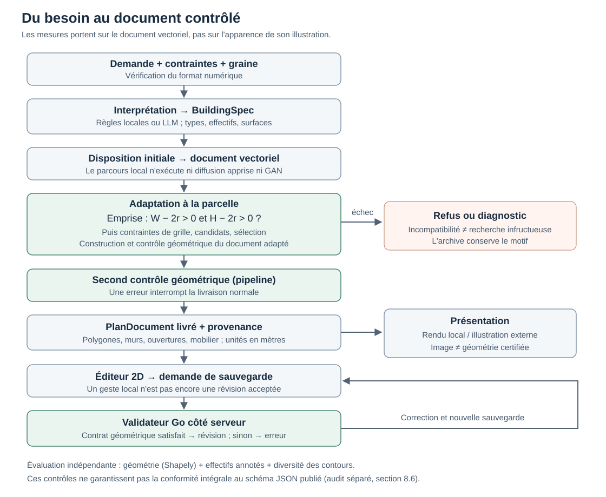
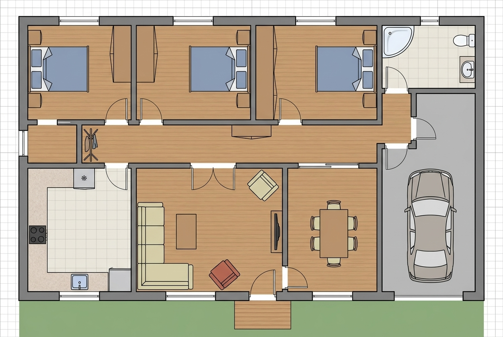
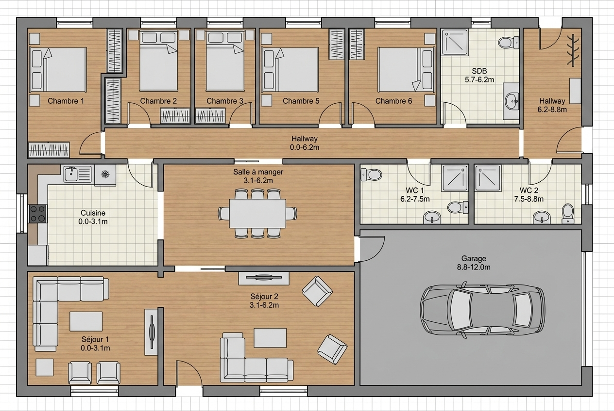
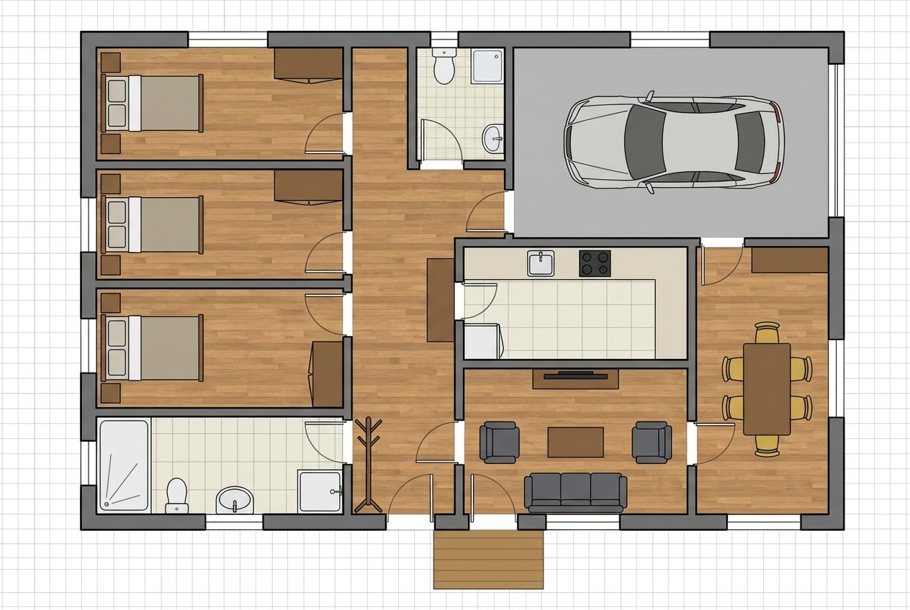
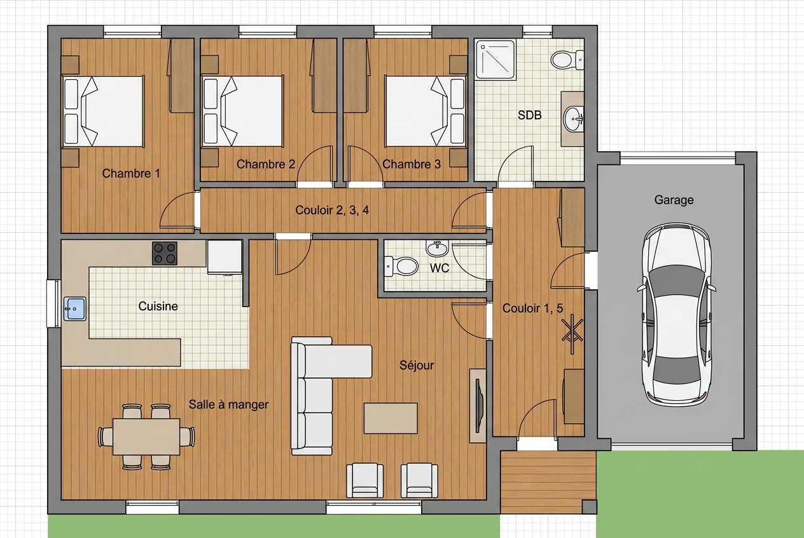
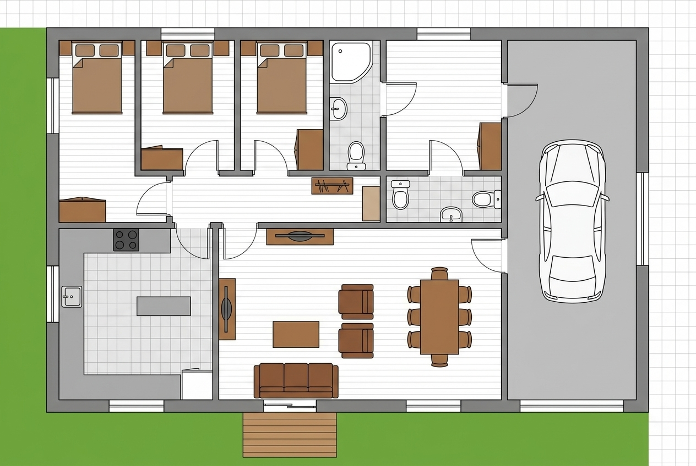

# De l’image plausible au plan vérifiable

Architecture et évaluation d’un système hybride pour la conception architecturale

Version du 30 septembre 2026

## Résumé

La génération automatique de plans architecturaux pose un problème de fiabilité : une image crédible peut représenter une géométrie invalide ou un logement contraire à la demande. Nous présentons A-AI, un système qui sépare interprétation du langage, construction géométrique, validation et présentation autour d’un document vectoriel commun. Nous évaluons séparément couverture, risque géométrique, respect des effectifs de pièces et diversité des dispositions. Les archives de développement comprennent vingt programmes et cinq graines. Le contrôle de faisabilité retire quinze livraisons incompatibles avec la parcelle, puis une correction d’ouverture porte la validité géométrique à 85 documents sur 85 retours. Le rendement combinant géométrie et conformité reste de 75 sur 95 demandes annotées, soit 78,95 %. Une nouvelle campagne sur dix programmes produit 45 retours sur 50 demandes, dont 40 satisfont les deux critères. Deux ablations conservent ces taux ; désactiver les variantes réduit cependant de treize à neuf le nombre de dispositions distinctes, compté par programme. Une expérience réelle de compréhension obtient des effectifs exacts sur 9/10 programmes d’évaluation avec le parseur local, 9/10 avec un LLM direct et 10/10 avec le même LLM intégré à A-AI. Ce dernier résultat inclut le post-traitement applicatif. L’apport est un protocole auditable reliant chaque résultat à son composant et à son dénominateur. Les petits corpus synthétiques et l’absence d’expérience exécutée avec un générateur spécialisé limitent la généralisation.

Un audit complémentaire révèle toutefois une dérive du catalogue de mobilier : la validité géométrique n'implique pas la conformité au schéma JSON publié.

Mots-clés : génération sous contraintes ; intelligence artificielle hybride ; plans architecturaux ; validation géométrique ; évaluation appariée ; statistiques appliquées.

## 1. Introduction

### 1.1 Une image convaincante peut représenter un problème mal résolu

Un plan semble crédible grâce à ses murs, à ses portes et à son mobilier. Cette apparence ne permet pourtant pas de savoir si une fenêtre tient dans son mur, si deux pièces se recouvrent ou si le bâtiment respecte l’emprise disponible. L’architecture combine relations spatiales, quantités physiques et usages. La ressemblance avec une image d’entraînement ne suffit pas à établir ces propriétés.

Le problème devient particulièrement visible lorsque la demande est exprimée en langage naturel. « Une maison de deux chambres sans garage » impose un effectif et une interdiction. La chaîne doit préserver ces informations jusqu’au document livré. Un garage peut être parfaitement rectangulaire et rester une erreur. Inversement, un programme de pièces exact peut être traduit en polygones invalides. Ces échecs appellent des corrections différentes.

Une représentation soignée facilite la communication, mais peut aussi rendre une erreur moins évidente. L’évaluation doit donc porter sur les données géométriques et sur le sens de la demande. Elle doit distinguer la qualité de la génération de celle du filtre qui accepte ou rejette une sortie. Un système qui refuse les cas difficiles n’a pas nécessairement appris à mieux les résoudre.

### 1.2 Question de recherche

Nous étudions la question suivante : **comment mesurer la fiabilité d’un système de génération architecturale lorsqu’il combine des propositions apprises, un moteur géométrique et une décision de livraison ?**

Notre réponse organise les responsabilités autour d’un document vectoriel. L’interpréteur construit un programme de pièces ; le moteur produit leurs coordonnées ; un validateur applique un contrat explicite ; le moteur graphique représente le document. Dans la configuration complète, un modèle de langage assiste l’interprétation et un service Gemini peut produire une illustration à partir d’un guide. Dans la campagne géométrique de cet article, ces services sont désactivés. L’expérience de langage les étudie séparément au niveau du programme.

Cette séparation permet de poser des hypothèses testables. Le rejet de faisabilité doit réduire les livraisons incompatibles avec la parcelle. Le choix entre plusieurs dispositions peut accroître la diversité sans améliorer la conformité sémantique. Un LLM peut mieux traiter une négation sans que cela établisse une amélioration des coordonnées. Chaque hypothèse demande une mesure adaptée.

### 1.3 Contributions et périmètre

La contribution est un cadre d’évaluation de système : document canonique, contrôle explicite, archivage par composant et analyse conjointe des retours et des échecs. L’étude fournit une formalisation géométrique, une campagne d’ablations sur des sources figées et une expérience réelle de compréhension. Elle expose les prérequis d’une comparaison équitable avec un générateur spécialisé préentraîné.

Le périmètre est la conception préliminaire de logements en deux dimensions, principalement orthogonaux. Le mot « valide » désigne la satisfaction du contrat géométrique décrit ici. La stabilité structurelle, la conformité réglementaire, la performance énergétique et l’accessibilité universelle ne sont pas déduites de ce contrat.

## 2. Travaux connexes et positionnement

### 2.1 Génération structurée de plans

Nauata et al. proposent House-GAN, qui conditionne la génération sur un graphe de types et de relations entre pièces [1]. Hu et al. développent Graph2Plan à partir d’un graphe de disposition et d’une enveloppe de bâtiment [2]. Ces travaux rendent explicite une partie des relations que la génération doit préserver.

Shabani et al. proposent HouseDiffusion, qui génère directement des contours vectoriels de pièces et de portes au moyen d’un modèle de diffusion [3]. Leng et al. introduisent Tell2Design pour la génération conditionnée par des descriptions linguistiques [4]. Ces formulations correspondent à des tâches différentes : un graphe structuré contient déjà certaines décisions que le texte laisse à interpréter.

Wang et Pajarola poursuivent la génération dans l’espace vectoriel avec DiffPlanner [5]. Zhang et Zhang intègrent des mécanismes de contrainte et des traitements spécialisés pour produire des plans accessibles [6]. Le choix de la représentation et celui des contraintes sont donc des parties constitutives de la méthode, pas seulement des détails de présentation.

### 2.2 Modèles de langage et résolution symbolique

La combinaison d’un modèle neuronal et d’un solveur n’est pas nouvelle. Kodnongbua, Curtis et Schulz articulent génération de contraintes, résolution symbolique et boucles de rétroaction dans la conception architecturale [7]. Littlefair, Dutt et Mitra utilisent un modèle de langage pour déterminer des objets et des contraintes d’aménagement dans FlairGPT [8].

Jacobson et Xue introduisent SPRING, qui incorpore un raisonnement symbolique dans la génération neuronale de configurations [9]. Xiang et al. associent un LLM et une optimisation entière sur grille dans Co-Layout [10]. Yang, Mao et Wang distinguent faisabilité spatiale et préférence esthétique dans Design-MLLM [11]. A-AI partage avec ces travaux l’importance des contraintes et la séparation entre exigences strictes et préférences.

Nous ne revendiquons ni l’invention de la combinaison neuro-symbolique ni une supériorité sur ces systèmes. Le tableau 1 précise le mécanisme documenté et la question examinée ici. L’absence d’un indicateur dans cette synthèse ne signifie pas qu’une méthode serait incapable de le produire.

| Travail | Mécanisme et place des contraintes | Relation avec notre étude |
|---|---|---|
| HouseDiffusion [3] | Diffusion de contours vectoriels conditionnée par graphe | Référence spécialisée à adapter au contrat commun |
| Zhang et Zhang [6] | Diffusion contrainte, exigences d’accessibilité et post-traitement | Exigences fonctionnelles plus spécialisées |
| Kodnongbua et al. [7] | Raisonnement neuronal puis solveurs avec rétroaction | Parenté neuro-symbolique directe |
| FlairGPT [8] | LLM, contraintes et optimisation d’aménagement | Aménagement intérieur, pas même tâche de logement complet |
| SPRING [9] | Raisonnement spatial incorporé à la génération | Contrainte intégrée au mécanisme génératif |
| Co-Layout [10] | LLM et optimisation entière des pièces et du mobilier | Optimisation conjointe différente du parcours local étudié |
| Design-MLLM [11] | Alignement par renforcement, faisabilité avant esthétique | Politique apprise non reproduite dans notre expérience |
| A-AI | Document partagé, contrôles explicites et traces distinctes | Mesure couverture–risque–rendement par programme |

Tableau 1. Positionnement méthodologique fondé sur les publications citées. Aucun score de ces travaux n’est importé dans nos tableaux.

### 2.3 Décision avec rejet et statistiques

El-Yaniv et Wiener étudient le compromis entre risque et couverture en classification sélective [12]. Nous employons cette distinction pour analyser la livraison d’un plan, sans transférer automatiquement les garanties d’un classificateur au générateur. Un refus fondé sur une emprise nulle est une incompatibilité identifiée ; une absence de candidat indique seulement une recherche infructueuse.

Le bootstrap d’Efron [13] et les intervalles de Wilson [14, 15] sont des outils établis. Leur emploi exige de choisir l’unité pertinente. Les graines d’une même demande sont corrélées : cinq variantes ne constituent pas cinq programmes indépendants. Zeng et al. proposent une évaluation multidimensionnelle des plans résidentiels [16], cohérente avec notre choix de distinguer géométrie, sémantique et apparence.

## 3. Architecture et chaîne de responsabilité

### 3.1 Du texte au document

L’entrée contient une demande et des contraintes de parcelle. L’interprétation produit un BuildingSpec composé de types de pièces, d’effectifs et de surfaces cibles. Un programme syntaxiquement décodable n’est pas nécessairement fidèle au texte. Le comptage attendu provient donc des annotations du corpus, pas de la sortie de l’interpréteur.

La construction spatiale produit des dispositions, puis des murs et des ouvertures. L’adaptation à la parcelle peut reconstruire les pièces : l’objet évalué est le PlanDocument final après adaptation. Il rassemble coordonnées, segments, références des ouvertures et mobilier, avec des unités en mètres.

Un service applicatif commun est appelé par HTTP et par les travaux asynchrones. Les fonctions géométriques ne dépendent pas des identifiants de travaux. Le validateur et l’évaluateur ont des implémentations distinctes. Cette organisation permet d’intervenir sur un composant sans confondre modification des données et changement d’apparence. Le contrat géométrique exécuté ne doit pas être assimilé à une validation intégrale du schéma JSON publié. L'audit historique de la section 8.7 montre un désaccord passé sur le catalogue; le réaudit post hoc sous le schéma courant est rapporté séparément.

L’éditeur modifie le même document. À la sauvegarde, le gestionnaire serveur appelle le validateur Go avant d’enregistrer une révision. Cette validation porte sur le contrat de document, pas sur toute la conformité à la demande initiale. Un geste d’édition local avant sauvegarde n’est pas assimilé à une révision serveur acceptée.

### 3.2 Cartographie

Figure 1. Parcours logique. Le contrôle d’emprise appartient à l’adaptation dans le logiciel ; il ne précède pas nécessairement tout calcul de disposition. Les contrôles géométriques du document se distinguent des filtres internes de placement et d'une validation intégrale du schéma JSON. Après édition, la sauvegarde repasse par le validateur serveur. L’illustration externe est une vue, pas la source des coordonnées.

### 3.3 Mécanismes réellement exécutés

Les noms historiques des modules peuvent suggérer des mécanismes qui ne tournent pas dans l’expérience. Le tableau 2 les explicite.

| Composant | Parcours géométrique mesuré | Service ou possibilité externe |
|---|---|---|
| NLU | Règles locales de lecture | gpt-oss-120b via Together dans l’expérience de compréhension |
| « diffusion » | Construction procédurale | Aucun réseau de diffusion évalué ici |
| « gan_refine » | Passage sans raffinement appris | Aucun GAN entraîné ou mesuré |
| « vectorize » | Assemblage géométrique | Pas de reconnaissance d’image raster |
| « adapt » | Placement et contrôles de parcelle | Même code dans les variantes locales |
| Présentation | Rendu local du document | Gemini via Eden configuré pour l’illustration |

Tableau 2. Noms logiciels et mécanismes actifs.

L’identifiant d’image configuré est google/gemini-3-pro-image-preview via Eden. Il est distinct d’openai/gpt-oss-120b, utilisé pour interpréter les demandes. Un nom de configuration ne prouve pas l’exécution d’un appel. Les anciennes images portent une réserve lorsque leur archive ne conserve pas la réponse du fournisseur.

Le Transformer est une architecture générale introduite par Vaswani et al. [17]. Ce terme n’établit ni la composition interne complète d’un service propriétaire ni sa fidélité géométrique. Le modèle d’image reçoit des instructions et un guide ; sa sortie n’est pas utilisée pour mesurer les polygones du document.

### 3.4 Algorithme de livraison

~~~text
Algorithme 1 — Parcours applicatif étudié
Entrées : demande, contraintes de parcelle, graine
1. Vérifier le format numérique des contraintes.
2. Construire le programme de pièces.
3. Produire une disposition initiale puis un document vectoriel.
4. Dans l’adaptation, calculer l’emprise utile et la grille.
5. Si une contrainte de parcelle échoue, retourner son diagnostic.
6. Chercher et sélectionner une disposition selon la politique active.
7. Construire le document adapté et vérifier son contrat.
8. Vérifier à nouveau le document au niveau du service de pipeline.
9. Produire la présentation et retourner le document avec sa provenance.
10. Après édition, appliquer le validateur serveur à la sauvegarde.
~~~

Une défaillance du contrôle final n’entraîne pas nécessairement la recherche d’un autre document. Le diagnostic « aucun candidat » n’est pas une preuve d’impossibilité architecturale. Cette distinction évite de prêter au code une optimisation exhaustive qu’il n’exécute pas.

## 4. Formalisation géométrique

### 4.1 Représentation et contraintes

Notons $b$ la demande, $c$ les contraintes et $z$ une graine locale. Le programme est $S=f_\theta(b,c)$, où $\theta$ représente les paramètres du modèle ou les règles locales. Le document proposé s’écrit $D=G(S,c,z)$. Cette notation ne suppose pas que $G$ soit neuronal.

Le document contient des pièces polygonales $P_1,\ldots,P_m$, des murs et des ouvertures. L’enveloppe admissible est $\Omega(c)$. Pour des polygones simples, les propriétés idéales étudiées comprennent :

$$
P_i\subseteq\Omega(c),\qquad A(P_i)>0,\qquad
\mu_2(P_i\cap P_j)=0\quad(i\ne j).
\tag{1}
$$

La dernière égalité permet le contact le long d’une frontière. L’évaluateur utilise des tolérances distinctes de longueur et d’aire, de l’ordre de $10^{-6}$ m et $10^{-6}$ m². Des coordonnées finies, des références cohérentes et des identifiants uniques complètent les exigences. Une liste de trois points ne suffit pas à établir la validité d’une pièce.

### 4.2 Aire et emprise utile

Pour des sommets ordonnés $(x_k,y_k)$, avec $(x_{n+1},y_{n+1})=(x_1,y_1)$, l’aire d’un polygone simple vaut :

$$
A(P)=\frac12\left|\sum_{k=1}^{n}
(x_k y_{k+1}-x_{k+1}y_k)\right|.
\tag{2}
$$

La valeur absolue rend l’aire indépendante du sens de parcours. La simplicité du contour reste une hypothèse : une somme algébrique calculable ne rend pas valide un polygone croisé. Un rectangle de 4 m sur 3 m donne 12 m² dans les deux orientations.

Pour une parcelle $W\times H$ et un retrait uniforme $r\ge0$, une condition nécessaire à une emprise utile positive est :

$$
W_u=W-2r>0,\qquad H_u=H-2r>0.
\tag{3}
$$

Cette condition ne prouve pas que toutes les pièces pourront être placées. Le logiciel ajoute des limites propres au moteur, notamment une taille minimale après discrétisation. Un refus « emprise non prise en charge » n’a pas le même statut logique qu’une largeur utile nulle. Remplacer une dimension négative par un minimum positif construirait une réponse à un autre problème.

### 4.3 Ouvertures et orientation des murs

Soient $a,b\in\mathbb R^2$ les extrémités d’un mur et $\ell=\|b-a\|_2>0$. Une ouverture de largeur $w>0$, située à un décalage $o$ depuis $a$, possède les extrémités :

$$
p_0=a+\frac{o}{\ell}(b-a),\qquad
p_1=a+\frac{o+w}{\ell}(b-a),\qquad
0\le o<o+w\le\ell.
\tag{4}
$$

Cette écriture reste correcte pour un mur vertical ou parcouru de droite à gauche. Deux ouvertures sur le même mur se recouvrent sur une longueur :

$$
L_{ij}=\max\left(0,\,
\min(o_i+w_i,o_j+w_j)-\max(o_i,o_j)\right).
\tag{5}
$$

Un contact exact peut être accepté par ce contrat tout en restant inadapté à la construction. Un trumeau, portion de mur entre deux ouvertures, demande une largeur minimale définie séparément.

## 5. Sélection et validation

### 5.1 Candidats et préférences

Dans une formulation idéale, on considère un ensemble fini $\mathcal C_K$ et un prédicat $V(D,c)$. L’ensemble admissible est $\mathcal C_K^V=\{D\in\mathcal C_K:V(D,c)=1\}$. La sélection s’écrit :

$$
D^\star\in\underset{D\in\mathcal C_K^V}{\arg\min}J(D,S),
\qquad \mathcal C_K^V\ne\varnothing.
\tag{6}
$$

Cette expression décrit une décision souhaitée, pas l’ordre littéral du logiciel. Certaines vérifications filtrent des dispositions intermédiaires ; d’autres contrôlent le document après adaptation. Tous les documents finaux ne sont donc pas nécessairement validés avant la sélection.

Une fenêtre de candidats quasi optimaux peut être définie par :

$$
\mathcal C_{K,\tau}^{V}
=\{D\in\mathcal C_K^V:J(D,S)\le J_{\min}+\tau\},
\qquad \tau\ge0.
\tag{7}
$$

Le score et $\tau$ utilisent la même unité conventionnelle. Une graine choisit parmi les candidats disponibles. Un meilleur score n’est pas une probabilité de validité ; des graines différentes peuvent sélectionner la même disposition.

### 5.2 Propriété conditionnelle du filtrage

Soit $\mathcal F_V(c)$ l’ensemble des documents satisfaisant les propriétés du contrat. Si le validateur est correct pour ce contrat, si toutes les sorties acceptées sont contrôlées et si aucune modification ultérieure non revalidée n’est livrée, alors :

$$
\Pr(D\notin\mathcal F_V(c)\mid a=1)=0,
\qquad \Pr(a=1)>0.
\tag{8}
$$

Cette propriété découle de $V(D,c)=1\Rightarrow D\in\mathcal F_V(c)$. Ce n’est pas un nouveau théorème d’apprentissage. Les tests exercent le logiciel sans constituer une preuve formelle de son validateur. La sauvegarde de l’éditeur repasse par le contrôle serveur, dont la portée reste celle du contrat documenté.

### 5.3 Le besoin est un objet distinct

Un document peut satisfaire le programme interprété $S$ alors que celui-ci diffère du besoin réel $S^\dagger$. Le garage créé malgré « sans garage » illustre cette distinction. Une vérification de polygones ne corrige pas une erreur d’interprétation dont elle n’a pas la représentation.

Trois rôles restent séparés : le score choisit, le validateur décide de la livraison et l’évaluateur mesure. L’évaluateur géométrique utilise Shapely sans réutiliser le placement. Cette indépendance d’implémentation réduit la circularité, mais une définition trop pauvre des contraintes pourrait rester commune aux composants.

## 6. Métriques et dénominateurs

### 6.1 Couverture, risque et rendement

Pour $N$ demandes, $a_i=1$ indique un document retourné. Parmi les retours, $v_i=1$ indique sa validité géométrique. Pour un refus, on fixe $v_i=0$ uniquement afin d’écrire les produits, sans prétendre avoir observé un document.

$$
\widehat C=\frac1N\sum_{i=1}^{N}a_i,\qquad
\widehat R_g=\frac{\sum_i a_i(1-v_i)}{\sum_i a_i}.
\tag{9}
$$

Le risque conditionnel n’est défini que lorsqu’au moins un document est retourné. Le rendement géométrique vaut :

$$
\widehat Y_g=\frac1N\sum_i a_i v_i
=\widehat C(1-\widehat R_g).
\tag{10}
$$

| Terme | Question posée | Dénominateur |
|---|---|---|
| Couverture | Quelles demandes obtiennent un document ? | Toutes les demandes |
| Risque géométrique | Quels documents livrés échouent au contrôle indépendant ? | Documents retournés |
| Rendement géométrique | Quelles demandes obtiennent un document valide ? | Toutes les demandes |
| Rendement combiné | Quelles demandes obtiennent un document valide et conforme aux effectifs ? | Toutes les demandes annotées |

Tableau 3. Quantités complémentaires. Refus de faisabilité, panne et sortie invalide restent distincts dans les observations.

### 6.2 Conformité aux effectifs et surfaces

Soit $I_P$ l’ensemble des demandes annotées et $p_i=1$ lorsque types et effectifs correspondent à l’annotation. Les segments de couloir sont regroupés pour ne pas confondre découpage graphique et nombre de fonctions de circulation. Le rendement combiné est :

$$
\widehat Y_{g,p}
=\frac{1}{|I_P|}\sum_{i\in I_P}a_i v_i p_i,
\qquad |I_P|>0.
\tag{11}
$$

Une annotation absente n’est ni un succès ni un échec. La conformité mesurée porte sur un dictionnaire d’effectifs, pas sur toute la sémantique. Elle ne vérifie pas directement qu’une cuisine est ouverte ou qu’une chambre n’a aucun accès direct à une salle de bain.

Pour $q$ cibles de surface $t_j>0$ explicitement annotées et appariées :

$$
E_A=\frac1q\sum_{j=1}^{q}
\frac{|A(P_j)-t_j|}{t_j},\qquad q\ge1.
\tag{12}
$$

L’absence de cible rend la mesure indisponible. Pour des pièces de même type, le tri des surfaces fournit une convention d’appariement, mais n’identifie pas automatiquement la chambre fonctionnellement correspondante.

### 6.3 Décomposition des contraintes sémantiques

Le protocole distingue absence, cardinalité exacte, cardinalité minimale et interdiction relationnelle. Une absence exige un effectif nul ; une cardinalité exacte impose $n_t=k$ ; une cardinalité minimale impose $n_t\ge k$. Une interdiction relationnelle porte sur une arête du graphe de circulation ou d’adjacence, dont la définition doit être fixée.

Les annotations actuelles mesurent les effectifs exacts. Le sous-ensemble « sans garage » révèle une erreur d’absence. Il ne constitue pas un banc d’essai complet de logique spatiale. Une future annotation de « au moins trois chambres » doit être distincte de celle de « exactement trois chambres ». Transformer a posteriori une égalité en minimum rendrait la difficulté artificiellement plus faible.

Pour chaque famille, il faut publier programmes, demandes annotées, réponses évaluables et violations. Les annotations supplémentaires seront fixées sans consulter les résultats des méthodes comparées.

### 6.4 Diversité géométrique et fidélité visuelle

Pour un programme $u$, soit $n_u$ le nombre de documents retournés et $H(D)$ une signature des pièces :

$$
U_u=\left|\{H(D_{u,s}):a_{u,s}=1\}\right|,
\qquad d_u=\frac{U_u}{n_u}\quad(n_u>0).
\tag{13}
$$

La signature conserve types et sommets arrondis au centimètre. Elle ignore l’ordre des pièces, le sommet initial, le sens du contour, les identifiants, la graine et les textures. Translations et rotations physiques restent différentes dans le repère de la parcelle. C’est un comptage de géométries, pas une diversité fonctionnelle. Pour un programme entièrement rejeté, $U_u=0$ et $d_u$ est indisponible.

La fidélité d’une illustration demanderait des masques sémantiques recalés. Pour des masques de murs $M_D,M_I$ dont l’union est non vide :

$$
\operatorname{IoU}(M_D,M_I)=
\frac{|M_D\cap M_I|}{|M_D\cup M_I|}.
\tag{14}
$$

Un seuillage des pixels sombres mélange murs, textes, ombres et mobilier. L’IoU n’est donc pas calculée sur les anciennes images sans annotation validée. Un plan plaisant ne reçoit aucun crédit géométrique automatique.

## 7. Protocole expérimental et statistique

### 7.1 Corpus et gel des sources

Le corpus contient vingt programmes de développement et dix étiquetés évaluation. La nouvelle campagne exécute ces dix derniers avec les graines 0 à 4. Les sources sont archivées avant génération et ne sont pas ajustées après lecture des résultats. Le corpus était visible dans le dépôt : cette séparation n’est pas un échantillon aveugle constitué par un tiers.

Trois variantes utilisent le même code : A-AI local ; A-AI sans les deux appels de validation finale dans l’adaptation et le service ; A-AI sans la politique de variantes, avec le parcours classique existant. La deuxième garde les contrôles de parcelle et les filtres internes de placement. « Sans validation finale » ne signifie donc pas « sans aucun contrôle ».

Le réseau est interdit durant ces générations. Les refus sont conservés. Un test du point d’entrée HTTP est exécuté séparément en mémoire ; il retourne un code 200 et un document. Cette vérification n’est pas un test du déploiement Docker complet ou de sa base.

### 7.2 Comparaisons appariées

Pour une mesure $y$, le contraste entre méthodes A et B est calculé par programme :

$$
\Delta_u=\frac1{|S_u|}\sum_{s\in S_u}
(y^B_{u,s}-y^A_{u,s}),\qquad
\overline\Delta=\frac1U\sum_{u=1}^{U}\Delta_u.
\tag{15}
$$

Le critère principal des ablations est le rendement combiné : une demande sans document conforme aux deux contrôles contribue zéro. Les clés programme–graine doivent coïncider ; les doublons sont interdits. Une métrique conditionnelle, comme la surface d’une pièce absente, n’est pas complétée arbitrairement par zéro.

Le bootstrap rééchantillonne les programmes avec remise, en gardant leurs cinq graines ensemble. Nous utilisons 2 000 réplications, avec la graine 20260930 :

$$
\overline\Delta^{*(b)}
=\frac1U\sum_{j=1}^{U}\Delta_{u_j^{(b)}}.
\tag{16}
$$

Les quantiles 2,5 % et 97,5 % donnent un intervalle percentile descriptif. Dans ce corpus choisi par les auteurs, il décrit surtout la sensibilité à sa composition. Il ne répare pas un biais de sélection.

### 7.3 Intervalles par programme

Pour $k$ succès parmi $n>0$ programmes, $\widehat p=k/n$ et $z=1{,}959964$, les bornes de Wilson à 95 % sont :

$$
\frac{\widehat p+z^2/(2n)\ \pm\
z\sqrt{\widehat p(1-\widehat p)/n+z^2/(4n^2)}}
{1+z^2/n}.
\tag{17}
$$

Pour la génération, un programme est entièrement réussi si ses cinq graines sont présentes, retournées et satisfont le critère. Les intervalles conditionnels portent sur les programmes entièrement retournés, avec les rejets publiés séparément. Pour la compréhension, chaque programme possède une réponse par méthode. L’interprétation binomiale demande indépendance et probabilité commune ; les intervalles sont ici descriptifs.

Avec zéro erreur sur $n$ programmes indépendants, la borne supérieure exacte unilatérale à 95 % est $1-0{,}05^{1/n}$. Elle vaut 16,16 % pour $n=17$ et 28,31 % pour $n=9$. Zéro erreur observée ne démontre donc pas un risque presque nul.

## 8. Résultats empiriques

### 8.1 Archives de développement

Les archives correspondent à vingt programmes et cinq graines. La consolidation du contrôle polygonal conserve les mêmes taux que la correction d’ouverture ; elle n’est pas présentée comme un gain supplémentaire.

| Version archivée | Demandes | Retours | Documents valides | Livraisons sur parcelle impossible |
|---|---:|---:|---:|---:|
| Avant contrôle de parcelle | 100 | 100 | 84 | 15 |
| Après contrôle de parcelle | 100 | 85 | 84 | 0 |
| Après correction des ouvertures | 100 | 85 | 85 | 0 |

Tableau 4. États successifs de développement, pas groupes indépendants.

Le contrôle de faisabilité réduit la couverture de 100 % à 85 %. Il ne crée aucun document valide supplémentaire : le rendement géométrique reste 84 %. Le risque conditionnel passe de 16/100 à 1/85, soit de 16 % à 1,18 %. L’intervention améliore la livraison en retirant des sorties impossibles.

### 8.2 Une correction géométrique ne corrige pas le sens

Dans dev07/2/0, déplacer le début d’une fenêtre de 1,40 m de large de 2,50 m à 2,40 m transforme les intervalles [2,50 ; 3,90] et [3,80 ; 6,20] en [2,40 ; 3,80] et [3,80 ; 6,20]. Le second intervalle correspond à une porte de garage. Le recouvrement passe de 0,10 m à zéro.

Le nombre de documents valides passe de 84 à 85 sur 85 retours, soit 1,18 point de validité conditionnelle. Cependant, dev07 demande un logement « sans garage ». La correction rend donc géométriquement valide un document qui reste incorrect par rapport au besoin.

Sur les 80 retours annotés, 75 respectent les effectifs. Le corpus comprend 95 demandes annotées : les quinze refus de parcelle en font partie ; les cinq variantes de dev17 n’ont pas cette annotation. Le rendement combiné est **75/95 = 78,95 %**, et non 75/80. Le second ratio, 93,75 %, décrit la conformité conditionnelle parmi les retours annotés.

| Mesure par programme retourné | Succès | Wilson 95 % descriptif |
|---|---:|---|
| Géométrie valide sur les cinq graines | 17/17 | [81,57 % ; 100 %] |
| Effectifs conformes sur les cinq graines, programmes annotés | 15/16 | [71,67 % ; 98,89 %] |

Tableau 5. Intervalles sur programmes, pas sur images. Trois programmes sont rejetés ; un programme retourné est non annoté pour les effectifs.

### 8.3 Nouvelle évaluation et ablations

La campagne du 30 septembre comprend 150 générations : dix programmes, cinq graines et trois variantes. Aucune génération n’est relancée pour améliorer son résultat.

| Variante | Demandes | Retours | Rejets | Valides | Conformes et valides | Rendement combiné |
|---|---:|---:|---:|---:|---:|---:|
| A-AI local | 50 | 45 | 5 | 45 | 40 | 80 % |
| Sans validation finale du document | 50 | 45 | 5 | 45 | 40 | 80 % |
| Sans variantes de disposition | 50 | 45 | 5 | 45 | 40 | 80 % |

Tableau 6. Observations nouvelles. Aucune erreur technique de génération ; eval06 produit les cinq refus attendus par variante. Parmi les retours, la conformité combinée vaut 40/45, soit 88,89 %.

Les deux différences appariées de rendement sont nulles. Le bootstrap produit [0 ; 0] parce que tous les contrastes observés sont nuls, pas parce que l’égalité des systèmes serait démontrée sur de nouvelles demandes. Retirer le contrôle final ne révèle aucun défaut supplémentaire dans ce lot ; les autres contrôles restent actifs.

Les cinq erreurs d’effectifs se concentrent sur eval07, qui demande quatre chambres « sans garage ». Le défaut local apparaît donc aussi dans l’évaluation. La géométrie est correcte pour 9/9 programmes retournés, intervalle [70,09 % ; 100 %]. Les effectifs sont conformes pour 8/9, intervalle [56,50 % ; 98,01 %].

### 8.4 Diversité produite

Avec les variantes actives, eval01, eval03, eval09 et eval10 produisent deux signatures parmi cinq graines ; les cinq autres programmes retournés en produisent une. La somme des signatures distinctes comptées par programme est treize. Sans variantes, chaque programme retourné possède une seule signature, soit neuf au total.

La moyenne de $d_u$ sur les neuf programmes retournés passe ainsi de $9/45=0{,}20$ à $13/45\approx0{,}289$. Ce résultat établit une diversité géométrique mesurable sans gain de rendement combiné. Il ne classe pas les solutions selon le confort ou la préférence.

### 8.5 Comparaison réelle avec un LLM généraliste

Le modèle demandé et déclaré dans les réponses est openai/gpt-oss-120b via Together. Les deux variantes utilisent le même message système de conventions de pièces, une température de 0,1 et une limite de 2 000 jetons de sortie. Le LLM direct ne reçoit pas de brouillon. La variante NLU A-AI reçoit le brouillon heuristique et son résultat passe par le post-traitement de production. Une réponse est demandée par programme et variante.

| Interprétation | Développement, succès / demandes annotées | Évaluation, succès / demandes annotées |
|---|---:|---:|
| Parseur local A-AI | 18/19 | 9/10 |
| LLM direct avec conventions communes | 16/19 | 9/10 |
| LLM intégré au NLU A-AI | 19/19 | 10/10 |

Tableau 7. Exactitude des effectifs au niveau du programme interprété, avant génération géométrique. Le dénominateur exclut seulement dev17, non annoté. Un échec technique compte comme absence de résultat correct dans le rendement linguistique, pas comme une réponse sémantiquement fausse observée.

Sur soixante appels tentés, cinquante-neuf réponses sont reçues. L’appel direct sur dev13 échoue avec une erreur de lecture réseau. La campagne s’arrête, puis reprend les demandes non encore tentées dans une seconde archive ; cet appel n’est pas rejoué. Sur développement, le LLM direct produit donc 16 programmes exacts parmi 18 réponses annotées, soit 88,89 % conditionnellement aux réponses, et 16/19, soit 84,21 %, sur les demandes annotées prévues.

Les deux variantes apprises traitent correctement « sans garage » sur dev07 et eval07. Sur eval01, le LLM direct omet le couloir attendu pour un studio avec WC séparé. L’intégration A-AI peut ajouter ce couloir par ses règles de normalisation. Le passage de 9/10 à 10/10 mesure donc l’effet du système intégré, pas une supériorité intrinsèque du modèle ni l’effet isolé du brouillon.

Les taux 9/10 et 10/10 ont respectivement des intervalles descriptifs de Wilson [59,58 % ; 98,21 %] et [72,25 % ; 100 %]. Un seul programme explique leur différence sur l’évaluation. La comparaison reste exploratoire : elle ne permet pas une conclusion générale sur les LLM ni sur la génération complète de plans.

Les usages retournés représentent environ 0,01250 USD au tarif public non remisé consulté le 30 septembre 2026. Cette estimation exclut tout éventuel coût de l’appel sans réponse et n’est pas une facture. Les réservations conservatrices de l’ensemble des soixante tentatives totalisent environ 0,09273 USD. Aucune image payante n’est générée dans cette expérience.

### 8.6 Comparaison géométrique avec HouseDiffusion

Une comparaison chiffrée est maintenant exécutée sur les dix programmes d’évaluation et les cinq graines contrôlées, soit 50 paires programme–graine. A-AI provient de l’archive locale figée ; HouseDiffusion utilise `model250000.pt`, le code local `vendor/house_diffusion` et 20 pas de diffusion. La sortie comparée est `house_diffusion+opt` : décodage des contours, `optimize_rooms`, puis reconstruction procédurale A-AI des murs et ouvertures avant conversion en `PlanDocument`. Les deux systèmes sont évalués par `research.metrics.geometry.evaluate`, avec les mêmes demandes, contraintes et dénominateurs. Les cinq cas de `eval06` sont refusés dans les deux parcours car l’emprise utile est non positive. Les résultats caractérisent donc l’intégration HouseDiffusion-adaptateur, pas le réseau natif sans post-traitement.

| Système | Tentatives | Retours | Géométrie valide parmi les retours | Succès combinés | Rendement combiné |
|---|---:|---:|---:|---:|---:|
| A-AI local | 50 | 45 | 45/45 | 40/50 | 80 % |
| HouseDiffusion | 50 | 45 | 45/45 | 15/50 | 30 % |

Tableau 8. Comparaison appariée avec évaluateur commun. Au niveau programme entièrement retourné, la géométrie est valide pour 9/9 programmes dans les deux groupes ; la conformité des effectifs concerne 8/9 programmes A-AI et 3/9 HouseDiffusion. Le contraste apparié du rendement combiné HouseDiffusion − A-AI est de −25/50, soit −50 points de pourcentage sur les paires observées. Les intervalles de Wilson descriptifs des programmes sont [70,09 % ; 100 %] pour la géométrie dans les deux groupes, [56,50 % ; 98,01 %] pour A-AI et [12,06 % ; 64,58 %] pour HouseDiffusion sur les effectifs.

La géométrie retournée par HouseDiffusion reste dans les parcelles et est très orthogonale. L’écart sémantique provient en partie de son mapping RPLAN : certains types du corpus, notamment `wc` et `laundry`, ne sont pas représentés directement, tandis que `garage` peut être codé comme `storage`. Cette limitation est comptée comme une non-conformité par le même évaluateur ; aucun remapping favorable n’est appliqué. Le résultat mesure donc le générateur intégré, son post-traitement et la couverture de son interface de types ; la qualité des contours natifs n’est pas isolée. Les documents, images, entrées et erreurs sont archivés dans [le rapport HouseDiffusion](../../benchmark/article-evaluation/house-diffusion-results.md).

Cette campagne est une comparaison descriptive à 20 pas de diffusion, pas une preuve de supériorité générale. Elle ne mesure ni accessibilité, ni dégagement du mobilier, ni conformité réglementaire, ni préférence esthétique.

### 8.7 Audit complémentaire du schéma publié

Après la campagne, un contrôle distinct a appliqué aux 135 documents retournés le schéma JSON Draft 2020-12 alors gelé avant les expériences. **Dans cet audit historique, aucun document ne satisfaisait intégralement le schéma** : les 1 785 diagnostics concernaient exclusivement l'énumération des identifiants de mobilier. Les observations et le schéma de cette analyse sont conservés sans modification dans P9.

Un réaudit post hoc, exécuté le 4 octobre 2026 sous le schéma courant après synchronisation de ses 22 IDs avec le catalogue 2D, classe **135/135 documents comme valides selon ce schéma**; aucun diagnostic ne subsiste. Le rapport [P11](../../benchmark/article-evaluation/schema-audit-current-20261004.json) enregistre les deux empreintes : le schéma choisi (`4532347c…`) diffère du schéma gelé (`455a566d…`). Ce résultat requalifie uniquement la conformité déclarative des mêmes documents sous une version ultérieure ; il ne remplace pas P9, ne modifie aucun document ni résultat de génération et ne constitue pas une nouvelle expérience. Il n'établit pas la conformité réglementaire, la constructibilité ni la qualité architecturale. Le profil géométrique d'exécution Python/Go et le schéma JSON strict ont des périmètres différents, comme précisé dans le [profil de validation](../../packages/plan-schema/validation-profile.md).

## 9. Figures, fidélité et provenance

### 9.1 Illustration générative

Les cinq illustrations sélectionnées par l’auteur sont conservées dans [selection-cinq-plans.json](selection-generations/selection-cinq-plans.json). Elles remplacent l’image G004 utilisée dans une version précédente du manuscrit.

| Plan | Illustration | Prompt utilisateur exact |
|---|---|---|
| G005 |  | « Maison 4 chambres, 1 salon, une salle à manger, une cuisine, un garage, une salle de bain » |
| G007 |  | « maison 6 chambres, 2 salon, salle à manger, une salle de bain, un garage, une cuisine, 2 toilette » |
| G010 |  | « maison 3 chambres, un salon, salle à manger, une salle de bain, un garage, une cuisine, une toilette » |
| G013 |  | « maison 3 chambres, un salon, une toilette, salle à manger, une salle de bain, un garage, une cuisine » |
| G015 |  | « maison 3 chambres, un salon, une toilette, salle à manger, une salle de bain, un garage, une cuisine » |
| — | — | Les retours à la ligne et espaces du fichier source sont normalisés uniquement dans ce tableau pour la lisibilité ; le JSON conserve le texte fourni. |

Figure 2. Cinq plans générés sélectionnés dans l’archive de l’auteur. Les journaux de cette période mentionnent Gemini via Eden, mais l’archive ne rattache pas individuellement un identifiant de modèle à chaque fichier ni le prompt technique complet. Ces illustrations sont hors des scores expérimentaux, et ne sont pas des captures de l’éditeur. Aucune barre d’échelle n’est ajoutée : le recalage métrique n’a pas été établi. Elles servent à montrer la variété visuelle des sorties et non à estimer un taux de réussite.

Une illustration expérimentale ne doit pas être retouchée pour masquer ses erreurs. Pour publier une figure métrique, il faudrait utiliser le document vectoriel correspondant et vérifier son échelle. Le choix de ces cinq images est une sélection illustrative demandée par l’auteur ; il ne constitue pas un échantillonnage permettant d’estimer un taux de réussite.

### 9.2 Rendu d’éditeur

Une expérience antérieure compare deux rendus de six documents à trois zooms et deux densités de pixels, avec deux états d’interaction supplémentaires. Les 38 paires de captures diffèrent visuellement, tandis que les empreintes sont conservées ; les six entrées JSON sont identiques octet par octet. Les 564 chargements d’éléments graphiques réussissent sans accès réseau.

Ces observations établissent la préservation des données dans les cas testés, pas une préférence visuelle des utilisateurs. Le temps de rendu n’a qu’une répétition par configuration ; l’écart historique de 1,28 % n’est pas interprété comme un gain de performance.

### 9.3 Traçabilité

Les archives conservent demandes, graines, documents, mesures et sources. Les empreintes identifient des contenus sans prouver à elles seules la validité de l’expérience. Pour les appels distants, les messages exacts, réponses, usages et modèles déclarés sont archivés sans clé d’accès.

La campagne locale a terminé ses 150 générations avant l’échec d’un contrôle HTTP auxiliaire : l’interdiction réseau bloquait une connexion locale utilisée par TestClient sous Windows. Les observations individuelles étaient déjà écrites. Elles ont été agrégées sans relancer les générateurs, avec une canonicalisation corrigée des signatures et un contrôle des groupes de graines. Le test HTTP séparé réussit. Cet incident du dispositif est conservé et n’est pas attribué à la pipeline.

## 10. Comparaison spécialisée et discussion

### 10.1 Comparer des tâches équivalentes

« A-AI contre un LLM contre un modèle préentraîné » ne définit pas seul une tâche commune : un LLM est également préentraîné. La distinction utile oppose une chaîne applicative, un modèle de langage généraliste et un générateur spécialisé de plans.

L’expérience linguistique compare la compréhension, à demande et conventions communes. La comparaison géométrique exécutée neutralise l'interprétation au niveau du corpus structuré : les sorties passent dans un évaluateur commun. Une réparation réservée à un concurrent modifierait la tâche ; les adaptations de format sont donc archivées et identiques dans leur rôle.

### 10.2 Référence spécialisée proposée

HouseDiffusion produit des contours vectoriels de pièces et de portes à partir de contraintes de graphe [3]. Le dépôt des auteurs fournit des instructions et un lien de modèle temporaire [18]. Cette compatibilité de représentation motive son choix ; elle ne remplace pas une expérience.

Un smoke test local postérieur à cette version charge désormais `model250000.pt` et produit trois sorties (`small-home`, `family-home`, `large-home`) avec l'adaptateur présent dans `services/ai/app/housediff.py`. Les trois sorties restent dans leur parcelle et contiennent les effectifs demandés dans ces cas, mais elles sont très orthogonales et schématiques. Les images et commentaires sont archivés dans [le rapport smoke test](../../benchmark/runs/house-diffusion-smoke-20260930/report.md) ; la comparaison appariée des dix programmes est détaillée dans [le rapport chiffré](../../benchmark/article-evaluation/house-diffusion-results.md).

Les poids et l'adaptateur local sont désormais disponibles et une première comparaison appariée est exécutée. Il faut encore confirmer les données autorisées, définir un graphe d'entrée plus riche et tester la conversion des coordonnées sur les capacités partagées. L'évaluation actuelle porte sur les dix programmes du corpus avec le mapping RPLAN existant ; un attribut absent n'a pas reçu de valeur supposée. **HouseDiffusion est mesuré dans une comparaison descriptive, mais pas encore dans une étude générale ou réglementaire.**

| Système | Sortie comparée | Statut |
|---|---|---|
| A-AI local | Document vectoriel | Génération et deux ablations exécutées |
| LLM généraliste direct | Programme de pièces JSON | Compréhension mesurée, 30 tentatives |
| A-AI avec NLU appris | Programme de pièces JSON | Compréhension mesurée, 30 tentatives |
| LLM générant directement des coordonnées | Géométrie | Non mesuré |
| HouseDiffusion préentraîné | Contours vectoriels | 10 programmes × 5 graines ; comparaison descriptive mesurée |

Tableau 9. Les lignes linguistiques ne forment pas une compétition de géométrie.

### 10.3 Apport pour l’intelligence artificielle

Un modèle peut améliorer une négation, mais cette amélioration n’a d’effet sur le plan livré que si les étapes suivantes préservent le programme. Un moteur peut produire des variantes supplémentaires sans accroître le nombre de demandes satisfaites. Un filtre peut réduire les sorties incorrectes sans créer de solution.

Le document commun rend ces différences observables. Il fournit un support pour apprendre ultérieurement à proposer ou corriger des plans, en gardant des mesures externes au modèle. Les données à collecter deviennent explicites : interprétation attendue, géométrie de référence lorsque pertinente, contraintes relationnelles, diagnostics et jugements d’usage indépendants.

### 10.4 Limites

Les trente demandes sont synthétiques, en français et choisies par les auteurs. Les annotations contiennent des conventions de logement implicites. Leur vérification par plusieurs architectes et leur extension à des demandes ambiguës sont nécessaires. Le jeu d’évaluation n’est pas indépendant au sens d’un recrutement extérieur.

La conformité publiée est une égalité d’effectifs. Les surfaces ne sont pas assimilées sans convention à des surfaces habitables réglementaires. L’absence de collision entre pièces n’établit pas le dégagement des portes, la circulation du mobilier ou l’accessibilité universelle. Certaines images historiques n’ont pas la provenance suffisante pour une attribution individuelle du modèle.

Le LLM est observé une fois par demande et variante. Une température faible n’assure pas sa répétabilité. Les intervalles sur dix programmes restent larges. Enfin, l’absence de défaut supplémentaire dans l’ablation ne démontre pas que le validateur serait inutile hors du corpus.

### 10.5 Travaux futurs

Les prochaines étapes sont la validation du mapping HouseDiffusion sur un graphe commun plus riche, la génération directe de coordonnées par le LLM et l’annotation fonctionnelle par des experts. Une étude de préférence visuelle devra anonymiser les méthodes, équilibrer l’ordre et rapporter l’accord entre évaluateurs. Les hypothèses pourront être préenregistrées ; les valeurs seront renseignées après mesure.

## 11. Conclusion

A-AI permet d’étudier séparément compréhension, construction géométrique, validation et représentation. Une correction peut retirer des livraisons impossibles, une autre réparer une ouverture, tandis qu’une erreur de négation subsiste. Le rendement combiné rend ces situations visibles.

Sur dix programmes d’évaluation, la chaîne locale produit 45 retours, dont 40 satisfont les critères géométriques et d’effectifs, sur 50 demandes. Les ablations ne changent pas ce rendement ; la politique de variantes augmente le nombre de dispositions. L’expérience de compréhension obtient 10 programmes exacts sur 10 avec le NLU intégré, contre 9 sur 10 avec le LLM direct et le parseur local. Ce résultat concerne une intégration logicielle, incluant ses conventions et son post-traitement.

L’apport est un protocole de fiabilité et d’attribution des effets accompagné de preuves inspectables. La comparaison HouseDiffusion montre une géométrie valide sur les retours mais une conformité sémantique plus faible avec le mapping RPLAN actuel. L'audit historique a révélé une incohérence du catalogue de mobilier; celle-ci a été corrigée dans le schéma, puis vérifiée rétrospectivement sur les mêmes documents, sans changer les observations de l'expérience. Cette validation de structure ne vaut ni validation architecturale ni conformité réglementaire. Une évaluation architecturale par experts reste à exécuter. Résultats observés, hypothèses et exigences de validation gardent ainsi des statuts distincts.

## Déclarations

Des outils d’IA générative ont assisté la rédaction, la relecture, la préparation des scripts et la vérification des calculs. Les résultats présentés proviennent des archives d’exécution ; aucune valeur simulée n’est présentée comme une mesure de performance. La responsabilité de validation et de soumission reste celle des auteurs.

Les noms, l’affiliation, le contact, le financement et les conflits d’intérêts doivent être renseignés et validés par les auteurs avant soumission.

## Disponibilité du code et des données

Les artefacts sont conservés dans le dépôt de travail A-AI. Le point Git de référence est e4bdd740fbd064298c1534b0ee5b888477a50677. Il ne suffit pas à reconstruire l’état expérimental, qui comprend des modifications locales ; les archives de sources et leurs manifestes SHA-256 l’identifient. Aucune URL publique pérenne ni DOI d’archive n’est revendiqué.

- [P1 — Contrôle de parcelle](../../benchmark/comparisons/3b-parcel/report.md).
- [P2 — Correction des ouvertures](../../benchmark/comparisons/3b-openings/report.md).
- [P3 — Observations historiques](../../benchmark/runs/3b-polygons-final/results.json).
- [P4 — Corpus](../../benchmark/cases/corpus.json).
- [P5 — Protocole expérimental](../../benchmark/article-evaluation/protocol.md).
- [P6 — Nouvelle génération et ablations](../../benchmark/runs/article-evaluation-20260930/analysis-summary.json).
- [P7 — Comparaison linguistique](../../benchmark/article-evaluation/llm-results.md).
- [P8 — Corrections et incidents](../sprints/article-evaluation-2.md).
- [P9 — Audit post hoc du schéma JSON](../../benchmark/article-evaluation/schema-audit.json).
- [P10 — Comparaison HouseDiffusion](../../benchmark/article-evaluation/house-diffusion-results.md).
- [P11 — Réaudit post hoc sous le schéma courant](../../benchmark/article-evaluation/schema-audit-current-20261004.json).

## Références bibliographiques

[1] Nauata, N., Chang, K.-H., Cheng, C.-Y., Mori, G. et Furukawa, Y. (2020). House-GAN: Relational Generative Adversarial Networks for Graph-constrained House Layout Generation. ECCV. [arXiv:2003.06988](https://arxiv.org/abs/2003.06988).

[2] Hu, R., Huang, Z., Tang, Y., van Kaick, O., Zhang, H. et Huang, H. (2020). Graph2Plan: Learning Floorplan Generation from Layout Graphs. ACM Transactions on Graphics, 39(4). [arXiv:2004.13204](https://arxiv.org/abs/2004.13204). DOI : 10.1145/3386569.3392391.

[3] Shabani, M. A., Hosseini, S. et Furukawa, Y. (2023). HouseDiffusion: Vector Floorplan Generation via a Diffusion Model with Discrete and Continuous Denoising. Proceedings of IEEE/CVF CVPR, 5466–5475. [Page des auteurs](https://shabani.me/housediffusion/).

[4] Leng, S., Zhou, Y., Dupty, M. H., Lee, W. S., Joyce, S. et Lu, W. (2023). Tell2Design: A Dataset for Language-Guided Floor Plan Generation. Proceedings of ACL, Volume 1: Long Papers, 14680–14697. [doi:10.18653/v1/2023.acl-long.820](https://aclanthology.org/2023.acl-long.820/).

[5] Wang, S. et Pajarola, R. (2025). Eliminating Rasterization: Direct Vector Floor Plan Generation with DiffPlanner. IEEE Transactions on Visualization and Computer Graphics, 31(10), 7906–7922. [Notice des auteurs](https://www.ifi.uzh.ch/en/vmml/publications/IEEE_DiffPlanner.html). DOI : 10.1109/TVCG.2025.3559682.

[6] Zhang, H. et Zhang, R. (2025). An Attention-Based Constrained Diffusion Model for Accessible Floor Plan Generation. Journal of Computing in Civil Engineering, 39(5). [doi:10.1061/JCCEE5.CPENG-6456](https://ascelibrary.org/doi/10.1061/JCCEE5.CPENG-6456).

[7] Kodnongbua, M., Curtis, L. H. et Schulz, A. (2024). Zero-shot Sequential Neuro-symbolic Reasoning for Automatically Generating Architecture Schematic Designs. Prépublication [arXiv:2402.00052](https://arxiv.org/abs/2402.00052).

[8] Littlefair, G., Dutt, N. S. et Mitra, N. J. (2025). FlairGPT: Repurposing LLMs for Interior Designs. Computer Graphics Forum, 44, e70036. [doi:10.1111/cgf.70036](https://onlinelibrary.wiley.com/doi/full/10.1111/cgf.70036).

[9] Jacobson, M. J. et Xue, Y. (2025). Integrating symbolic reasoning into neural generative models for design generation. Artificial Intelligence, article 104257. [doi:10.1016/j.artint.2024.104257](https://www.sciencedirect.com/science/article/pii/S0004370224001930).

[10] Xiang, C., Bao, R., Feng, B., Wu, W., Liu, Z., Guan, Y. et Liu, L. (2026). Co-Layout: LLM-driven Co-optimization for Interior Layout. Proceedings of AAAI, 40(17), 14371–14379. [doi:10.1609/aaai.v40i17.38452](https://ojs.aaai.org/index.php/AAAI/article/view/38452).

[11] Yang, Y., Mao, X. et Wang, J. (2026). Design-MLLM: A Reinforcement Alignment Framework for Verifiable and Aesthetic Interior Design. Prépublication [arXiv:2603.13312v3](https://arxiv.org/abs/2603.13312v3), version du 21 juin 2026.

[12] El-Yaniv, R. et Wiener, Y. (2010). On the Foundations of Noise-free Selective Classification. Journal of Machine Learning Research, 11, 1605–1641. [Article](https://jmlr.org/papers/v11/el-yaniv10a.html).

[13] Efron, B. (1979). Bootstrap Methods: Another Look at the Jackknife. The Annals of Statistics, 7(1), 1–26. [doi:10.1214/aos/1176344552](https://doi.org/10.1214/aos/1176344552).

[14] Wilson, E. B. (1927). Probable Inference, the Law of Succession, and Statistical Inference. Journal of the American Statistical Association, 22(158), 209–212. DOI : 10.1080/01621459.1927.10502953. Formulation consultable dans [15].

[15] NIST/SEMATECH. e-Handbook of Statistical Methods, section 7.2.4.1, Confidence intervals. [Manuel officiel](https://www.itl.nist.gov/div898/handbook/prc/section2/prc241.htm). Consulté le 30 septembre 2026.

[16] Zeng, P., Yin, J., Gao, Y., Li, J., Jin, Z. et Lu, S. (2025). Comprehensive and Dedicated Metrics for Evaluating AI-Generated Residential Floor Plans. Buildings, 15(10), 1674. [doi:10.3390/buildings15101674](https://www.mdpi.com/2075-5309/15/10/1674).

[17] Vaswani, A., Shazeer, N., Parmar, N., Uszkoreit, J., Jones, L., Gomez, A. N., Kaiser, Ł. et Polosukhin, I. (2017). Attention Is All You Need. Advances in Neural Information Processing Systems, 30. [arXiv:1706.03762](https://arxiv.org/abs/1706.03762).

[18] Shabani, M. A., Hosseini, S. et Furukawa, Y. HouseDiffusion, code et instructions de reproduction. [Dépôt des auteurs](https://github.com/aminshabani/house_diffusion). Consulté le 30 septembre 2026.

## Annexe A Vérifications élémentaires

### A.1 Surfaces et unités

Sur une parcelle de 10 m sur 8 m, un retrait de 1 m donne une emprise de 8 m sur 6 m, soit 48 m². Trois cibles de 12, 9 et 20 m² totalisent 41 m². Leur somme respecte la condition nécessaire de surface, mais ne prouve pas l’existence d’une disposition avec ouvertures et circulation.

Des surfaces obtenues de 12, 8 et 22 m² donnent :

$$
E_A=\frac{0+1/9+2/20}{3}\approx0{,}07037=7{,}04\%.
$$

C’est un exemple de calcul, pas une observation supplémentaire. L’indicateur est sans unité et ne mesure pas l’accessibilité.

### A.2 Repère des ouvertures

Pour $a=(10,0)$, $b=(0,0)$, $o=2$ m et $w=0{,}9$ m, l’équation (4) donne $p_0=(8,0)$ et $p_1=(7{,}1,0)$. Le décalage part de la première extrémité du mur, pas de l’origine globale. Cette convention doit être identique dans la génération, l’édition et le rendu.

### A.3 Dénominateurs et contre-exemple

Après contrôle de parcelle, $\widehat C=85/100$, $\widehat R_g=1/85$, et $\widehat Y_g=(85/100)(84/85)=84/100$. Après correction d’ouverture, le rendement géométrique atteint 85/100. Le rendement combiné reste 75/95 : le document réparé appartient à la demande « sans garage » encore mal interprétée.

Une différence d’effectifs suffit à réfuter une conformité universelle. L’absence de défaut dans un corpus fini ne démontre pas l’inverse. Conserver les contre-exemples et les incidents fait donc partie du résultat scientifique.
