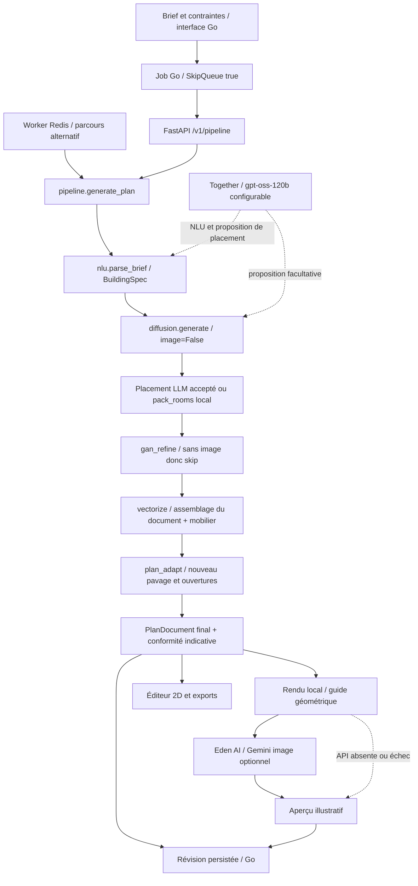

# Audit scientifique de la pipeline 2D

Date : 2026-09-22. État étudié : checkout local avec modifications non commitées,
HEAD `e4bdd740fbd064298c1534b0ee5b888477a50677`. Analyse statique ; aucune
supériorité expérimentale n'est établie par cet audit. La 3D reste hors périmètre.

## Conclusion

Le système est une chaîne hybride : interprétation de programme, placement
géométrique heuristique éventuellement proposé par un LLM, adaptation, puis
illustration optionnelle par Gemini. Cette séparation constitue une base
d'ingénierie cohérente. Elle ne démontre ni nouveauté algorithmique ni gain de
qualité architecturale. Une contribution scientifique défendable exige les
expériences appariées décrites dans [le protocole](../benchmark/README.md).

La demande porte sur la pipeline qui utilise Gemini dans l'application,
et non sur une expertise rédigée par Gemini. Les conclusions proviennent de
la lecture du code et des publications citées ; aucun appel image externe
n'a été effectué pour cet audit.

## Cartographie du parcours produit

Les flèches vers le LLM représentent des appels conditionnels à la configuration,
pas une dépendance obligatoire. `generate_flux_plan` peut aussi solliciter
`_plan_furniture_with_llm` pour les consignes du prompt image. Ce mobilier textuel
ne constitue pas une modification du mobilier vectoriel.

| Étape et preuve dans le code | Entrée → sortie | Limite observée |
|---|---|---|
| `internal/httpapi/handlers_api.go`, `SkipQueue: true`; `internal/jobs/service.go`, appel `/v1/pipeline` | Requête → job et appel HTTP | Le worker Redis n'est pas le chemin web normal |
| `services/ai/app/nlu.py`, `parse_brief` | Brief/contraintes → dictionnaire BuildingSpec | Together facultatif ; repli heuristique ; JSON ne suffit pas à prouver la validité sémantique |
| `services/ai/app/diffusion.py`, `generate` | Programme → layout, murs, ouvertures | Pas de diffusion apprise sur ce parcours ; image désactivée par le cas d'usage |
| `services/ai/app/gan_refine.py`, `refine` | Layout sans image → même layout | Retour `gan_refine_skip` ; aucun gain GAN possible dans ce parcours |
| `services/ai/app/vectorize.py`, `vectorize` | Layout → PlanDocument | Assemblage de géométrie existante, pas reconstruction depuis le raster |
| `services/ai/app/plan_adapt.py`, `adapt` | Document, parcelle, règles → document repavé | Les polygones initiaux ne sont pas préservés ; dimensions utiles forcées à un minimum |
| `services/ai/app/diffusion.py`, `preview_from_document`, `generate_flux_plan` | Document final → guide puis image | Un guide conditionne l'image mais ne certifie pas sa fidélité |
| `services/ai/app/together_image.py`, `_via_eden` | Prompt + guide → image API | Modèle configuré `google/gemini-3-pro-image-preview`; appels de reprise possibles |

Les noms `flux`, `diffusion`, `vectorize` et les événements de progression sont
historiques. `steps` mentionne toujours Gemini même lorsque le rendu est local.
`preview_from_document` peut conserver `flux-skipped` ou `flux-failed` comme
méthode malgré un PNG local réussi. Un benchmark devra capturer les étapes
réellement exécutées, le fournisseur, le modèle et les motifs de repli.

## Patterns : existants et limites

| Pattern | Observation | Appréciation |
|---|---|---|
| Service applicatif / orchestration | `pipeline.generate_plan` partagé par HTTP et Redis | Réduit la divergence des séquences ; bon point de séparation |
| Adaptateurs de transport | `api.py`, `worker.py`, `job_progress.py` | Orientation ports/adaptateurs partielle ; dépendances globales et environnement encore présents |
| Injection par callback | Argument `progress` | Le cas d'usage ignore les identifiants de jobs ; testabilité améliorée |
| Document canonique | PlanDocument alimente rendu local, éditeur et exports | Bonne base de cohérence ; retouches raster seules violent cette intention |
| Sélection de stratégies et repli | LLM/local, Gemini/local, partis de placement | Branches explicites, sans nécessité d'une hiérarchie de classes ; provenance insuffisante |
| Noyau géométrique séparé | `plan_geometry`, `plan_walls`, `plan_openings` | Responsabilités concrètes ; validation globale à renforcer |
| Façade de compatibilité | Réexports historiques depuis `diffusion.py` | Migration progressive utile ; module toujours chargé de prompts, édition et coordination |

Il ne s'agit pas d'une architecture hexagonale complète ni d'un entraînement
de bout en bout. Ajouter des interfaces partout n'améliorerait pas en soi la méthode.

## Risques pour la validité scientifique

1. **Attribution causale incorrecte.** Le repavage final peut effacer les positions
   du LLM. Mesurer ses sorties intermédiaires sans évaluer le document final
   surestime potentiellement son apport. Comparer avec/sans proposition LLM,
   à BuildingSpec, budget de candidats et adaptation identiques.
2. **Ablation sans mécanisme actif.** `research/benchmarks/run_ablation.py`
   appelle `generate` puis `vectorize`, sans `plan_adapt`. Le raffinement conserve
   le layout. Ses scores vectoriels ne mesurent donc pas l'effet raster du GAN
   et ne représentent pas la pipeline produit finale.
3. **Métriques faibles.** `research/metrics/topology.py::closed_perimeter`
   vérifie essentiellement quatre murs et des dimensions positives ; quatre
   segments disjoints peuvent réussir. `room_polygons_valid` ne vérifie que
   trois sommets, pas les intersections ni l'aire. Le comptage dans
   `constraints.py` ignore les types et peut confondre segments de couloir et pièces.
4. **Fidélité confondue avec esthétique.** `raster.wall_iou` seuillle les pixels
   sombres : sur un plan meublé, texte et mobilier contaminent le masque.
   Une IoU de murs exige un masque de murs identifié indépendamment, à projection
   commune. Un joli rendu Gemini ne prouve ni accessibilité ni respect des surfaces.
5. **Faisabilité masquée.** `adapt` force une emprise minimale même si la
   parcelle et ses retraits ne la permettent pas. Une entrée impossible doit
   être reconnue explicitement dans l'évaluation.
6. **Évaluation circulaire.** Optimiser puis évaluer avec le même score interne
   ne suffit pas. Séparer score de sélection, évaluateur géométrique indépendant
   et appréciation d'experts aveugles à la version.
7. **Reproductibilité limitée.** Graines, prompts, modèle effectivement servi,
   appels réseau, échecs, versions locales non commitées et coûts doivent être
   archivés. Une graine locale ne rend pas une API d'image déterministe.

Les seuils de surfaces ou de passage du dépôt sont des paramètres du produit,
pas une certification réglementaire. Aucune validation constructive n'est démontrée.

## Positionnement recherche et hypothèses testables

HouseDiffusion génère directement des coordonnées vectorielles par diffusion ;
c'est une approche différente de l'illustration d'un document déjà calculé.
[Publication CVPR 2023](https://openaccess.thecvf.com/content/CVPR2023/html/Shabani_HouseDiffusion_Vector_Floorplan_Generation_via_a_Diffusion_Model_With_Discrete_CVPR_2023_paper.html).

Graph2Plan conditionne la génération par graphe de disposition et enveloppe.
Cela motive l'évaluation explicite des adjacences, mais ne prouve pas une
équivalence du moteur actuel avec ce modèle.
[Publication des auteurs](https://arxiv.org/abs/2004.13204).

Google documente la génération et l'édition d'images conditionnées par image.
Ces capacités ne fournissent pas, dans notre intégration, une vérification
géométrique du PlanDocument.
[Documentation Gemini](https://ai.google.dev/gemini-api/docs/image-generation).

Hypothèses à préenregistrer, et non résultats acquis :

- H1 : un validateur final indépendant réduit les plans invalides livrés,
  en publiant aussi le taux de rejet et le taux de succès total.
- H2 : un graphe de circulation par portes augmente la proportion de pièces
  accessibles, à programme et budget de recherche identiques.
- H3 : Gemini améliore la préférence esthétique en évaluation aveugle,
  sous contrainte explicite de fidélité ; l'hypothèse peut être rejetée.
- H4 : une refonte graphique locale améliore la lisibilité sans changer le
  document canonique ni augmenter excessivement le temps de rendu.

Contribution raisonnablement envisageable : étude reproductible d'une chaîne
hybride sous contraintes, avec séparation qualité spatiale/fidélité/esthétique,
ablation des composants actifs et analyse des échecs. La nouveauté et la
publication restent à démontrer par revue bibliographique approfondie et résultats.

## Traçabilité des prochaines étapes

Le [plan d'implémentation](refactor-mvp-2d-1.md) précise les dépendances, tests et
revues. Le dossier [benchmark](../benchmark/README.md) définit les comparaisons
obligatoires. Aucune modification fonctionnelle n'est livrée avec cet audit.
